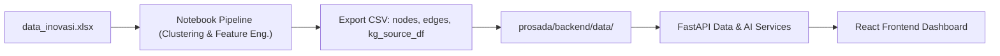

# Prosada-Final: Data Science & Knowledge Graph Pipeline

Folder ini berisi seluruh pipeline data science, eksperimen clustering, ekstraksi Knowledge Graph, dan prototipe Graph RAG untuk inovasi pemerintah daerah di Jawa Timur.

Hasil dari pipeline di folder ini diekspor ke format CSV yang menjadi basis data utama bagi aplikasi **PROSADA Web Application** (`prosada/backend/data/`).

---

## 📂 Struktur Berkas

| Berkas / Direktori | Deskripsi |
|---|---|
| `Pipeline_Inovasi_Jawa_Timur_Clustering_to_Knowledge_Graph_Final.ipynb` | Pipeline utama: pra-pemrosesan data, feature engineering, clustering kematangan inovasi kab/kota & provinsi, serta ekstraksi entitas & relasi Knowledge Graph. |
| `02_Knowledge_Graph_Graph_RAG_STEP5_FIXED.ipynb` | Konstruksi Knowledge Graph menggunakan NetworkX, perhitungan bobot relasi dominan, dan eksperimen algoritma Graph RAG. |
| `03_Graph_RAG_GenAI_FINAL.ipynb` | Eksperimen integrasi LLM (Groq API) dengan Knowledge Graph dan evaluasi Explainable AI (XAI). |
| `data_inovasi.xlsx` | Dataset mentah inovasi daerah Jawa Timur (IGA / BRIDA Jatim). |
| `kg_source_df.csv` | Dataset hasil pembersihan dan penambahan label cluster per inovasi. |
| `knowledge_graph_nodes.csv` | Node Knowledge Graph (Inovasi, Daerah, OPD, Urusan, Bentuk, Jenis, Tahapan, Asta Cipta, Profil). |
| `knowledge_graph_edges.csv` | Relasi graf terstruktur (termasuk relasi berbobot `DOMINAN_*`). |
| `innovation_knowledge_graph.graphml` | File graf lengkap dalam format GraphML standar untuk visualisasi di Gephi / Cytoscape. |

---

## 🔄 Alur Integrasi ke PROSADA Web Application

1. **Eksplorasi & Clustering**: Dijalankan di notebook Jupyter untuk menghasilkan klaster profil inovasi berdasarkan kematangan dan karakteristik dominan.
2. **Ekstraksi Graf**: Node dan relasi Knowledge Graph diekspor ke file CSV (`knowledge_graph_nodes.csv` dan `knowledge_graph_edges.csv`).
3. **Penyelarasan Data**: CSV disinkronkan ke direktori `prosada/backend/data/` untuk dibaca oleh backend FastAPI secara efisien dengan in-memory caching (`@lru_cache`).
