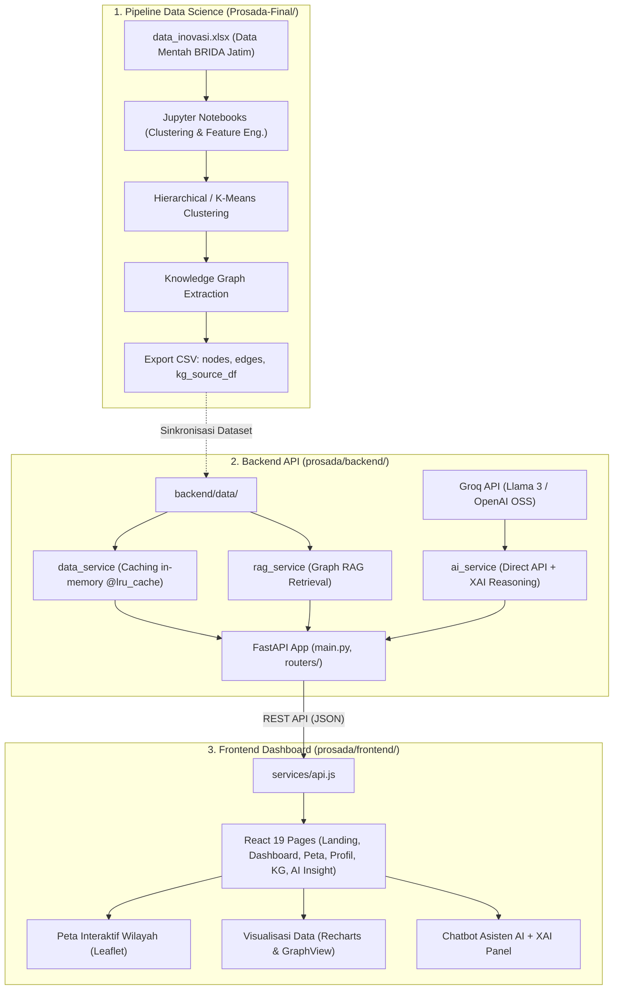

# PROSADA — JUSTINFO
### Platform Analitik, Clustering & Knowledge Graph Inovasi Daerah Jawa Timur

[](https://fastapi.tiangolo.com/)
[](https://react.dev/)
[](https://vitejs.dev/)
[](https://tailwindcss.com/)
[](https://groq.com/)
[](https://opensource.org/licenses/MIT)

PROSADA (Provincial Innovation Analytics Dashboard) di bawah inisiatif **JUSTINFO** adalah sistem komprehensif yang mengintegrasikan pipeline **Data Science**, **Clustering Machine Learning**, **Knowledge Graph (1.073 node & 5.817 relasi)**, serta **Graph RAG / Explainable AI (XAI) Chatbot** untuk memetakan dan menganalisis ekosistem inovasi pemerintah daerah di seluruh wilayah Jawa Timur.

---

## 🏛️ Arsitektur Sistem

Repository ini terbagi menjadi dua komponen utama:



---

## 📂 Struktur Direktori Repositori

```
Project-Data-Science/
├── Prosada-Final/                      # Eksperimen Data Science & Pipeline Knowledge Graph
│   ├── 02_Knowledge_Graph_Graph_RAG_STEP5_FIXED.ipynb
│   ├── 03_Graph_RAG_GenAI_FINAL.ipynb
│   ├── Pipeline_Inovasi_Jawa_Timur_Clustering_to_Knowledge_Graph_Final.ipynb
│   ├── data_inovasi.xlsx              # Dataset mentah inovasi
│   ├── innovation_knowledge_graph.graphml # File graf format GraphML
│   ├── kg_source_df.csv               # Dataset hasil clustering
│   ├── knowledge_graph_edges.csv      # Relasi graf berbobot
│   ├── knowledge_graph_nodes.csv      # Node entitas Knowledge Graph
│   └── README.md                      # Dokumentasi teknis pipeline
│
├── prosada/                           # Aplikasi Web Siap Deploy
│   ├── backend/                       # REST API (FastAPI)
│   │   ├── core/                      # Config (Pydantic Settings) & Middleware CORS
│   │   ├── data/                      # Dataset CSV Knowledge Graph aktif
│   │   ├── routers/                   # Endpoint data analitik & AI
│   │   ├── schemas/                   # Model Pydantic input/output
│   │   ├── services/                  # data_service, ai_service, rag_service
│   │   ├── .env.example               # Template variabel environment backend
│   │   ├── main.py                    # Entry point uvicorn
│   │   ├── Procfile                   # Konfigurasi deployment Railway/Heroku
│   │   └── requirements.txt           # Dependensi Python
│   │
│   └── frontend/                      # Web Client (React 19 + Vite + Tailwind CSS)
│       ├── src/
│       │   ├── assets/                # Gambar, logo JUSTINFO, dan ikon
│       │   ├── components/            # Komponen UI (WilayahMap, BarList, GraphView, ChatbotWidget, dll.)
│       │   ├── hooks/                 # Custom React hooks (useFetch)
│       │   ├── lib/                   # Format utilities & color tokens (fmt, TK_COLOR)
│       │   ├── pages/                 # Halaman utama aplikasi
│       │   ├── services/              # API Client (ai.js, api.js, data.js)
│       │   ├── App.jsx                # Router & Layout
│       │   └── main.jsx               # Root entry React
│       ├── .env.example               # Template variabel environment frontend
│       ├── index.html                 # Dokumen HTML utama
│       ├── package.json               # Dependensi Node.js
│       ├── vercel.json                # Konfigurasi routing rewrite Vercel
│       └── vite.config.js             # Konfigurasi bundler Vite
│
├── .gitignore                         # Git ignore terpadu untuk Python, Node, OS, & secret env
└── README.md                          # Panduan utama proyek
```

---

## ✨ Fitur Utama

1. **Dashboard Eksekutif Inovasi**: Metrik agregat seluruh Jawa Timur (679 inovasi, 36 pemda, ratusan OPD, rata-rata kematangan, dan persentase inovasi tahap penerapan).
2. **Peta Interaktif Sebaran Wilayah**: Peta berbasis **Leaflet** memvisualisasikan 38 kabupaten/kota dengan ukuran lingkaran proporsional terhadap jumlah inovasi dan warna indikator kematangan (*Tinggi*, *Sedang*, *Rendah*).
3. **Profil Ekosistem & Karakteristik Inovasi**: Penelusuran karakteristik dominan tiap cluster (*Jenis*, *Bentuk*, *Urusan Pemerintahan*, dan *Tahapan Inovasi*) berdasarkan relasi berbobot graf.
4. **Knowledge Graph Explorer**: Eksplorasi graf multi-relasi inovasi daerah yang menghubungkan daerah, OPD pengelola, urusan, serta pilar Asta Cipta.
5. **AI Insight & Explainable AI (XAI)**:
   - Tanya jawab berbasis LLM (Groq Cloud) yang didasarkan langsung pada fakta Knowledge Graph (*grounded*).
   - Panel XAI transparan menampilkan alur penalaran, entitas graf yang ditelusuri, relasi kunci, dan tingkat keyakinan jawaban.
   - Fallback otomatis ke knowledge graph retrieval jika API key LLM belum dikonfigurasi.
   - Floating Chatbot Widget responsif di semua halaman dashboard.

---

## ⚡ Panduan Instalasi & Menjalankan Lokal

### Prasyarat
- Python 3.10 atau versi lebih baru
- Node.js 18+ dan npm

### 1. Menjalankan Backend (FastAPI)

```bash
# Masuk ke direktori backend
cd prosada/backend

# Buat virtual environment (opsional namun disarankan)
python -m venv .venv
# Aktivasi virtual environment:
# Windows: .venv\Scripts\activate
# Linux/macOS: source .venv/bin/activate

# Install dependensi
pip install -r requirements.txt

# Salin template environment
cp .env.example .env

# Jalankan server API
uvicorn main:app --reload --host 127.0.0.1 --port 8000
```

> **Catatan**: Akses Swagger UI di [http://localhost:8000/docs](http://localhost:8000/docs) dan health check di [http://localhost:8000/health](http://localhost:8000/health).

### 2. Menjalankan Frontend (React + Vite)

```bash
# Buka terminal baru dan masuk ke direktori frontend
cd prosada/frontend

# Install dependensi Node
npm install

# Salin template environment
cp .env.example .env

# Jalankan frontend development server
npm run dev
```

> Buka peramban di [http://localhost:5173](http://localhost:5173).

---

## 📡 Dokumentasi Endpoint API

| Metode | Rute Endpoint | Fungsi / Payload |
|---|---|---|
| `GET` | `/health` | Pemeriksaan status server (`{"status": "ok"}`) |
| `GET` | `/data/ringkasan` | Statistik agregat inovasi, jenis, bentuk, tingkat kematangan, dan top wilayah |
| `GET` | `/data/wilayah` | Daftar wilayah kab/kota, total inovasi, skor kematangan, dan titik koordinat |
| `GET` | `/data/profil` | Profil ekosistem wilayah dan karakteristik provinsi beserta bobot dominan |
| `GET` | `/data/kg` | Total node dan relasi Knowledge Graph per kategori |
| `GET` | `/ai/status` | Status integrasi Groq AI dan ringkasan ukuran graf |
| `POST` | `/ai/chat` | Chatbot multi-turn dengan XAI: `{"pertanyaan": "...", "history": [...]}` |
| `POST` | `/ai/rag` | Graph RAG terarah: `{"pertanyaan": "...", "pakai_genai": true}` |

---

## 🛠️ Konfigurasi Deployment

### Deployment Backend (Railway / Render)
1. Pilih repository ini di Railway / Render.
2. Tetapkan **Root Directory** ke `prosada/backend`.
3. Set variabel environment:
   - `FRONTEND_URL`: URL aplikasi frontend production (contoh: `https://prosada.vercel.app`).
   - `GROQ_API_KEY`: API key Groq (opsional untuk mode GenAI penuh).
   - `GROQ_MODEL`: Model Groq LLM (default: `openai/gpt-oss-120b` atau `llama-3.3-70b-versatile`).
4. Server akan otomatis dijalankan melalui konfigurasi `Procfile`.

### Deployment Frontend (Vercel)
1. Hubungkan repository ke Vercel.
2. Tetapkan **Root Directory** ke `prosada/frontend`.
3. Framework preset terdeteksi otomatis sebagai **Vite**.
4. Set variabel environment:
   - `VITE_API_URL`: URL backend Railway production (contoh: `https://prosada-backend.up.railway.app`).
5. File `vercel.json` telah disertakan untuk mendukung routing SPA di Vercel.

---

## 🔒 Keamanan & Praktik Terbaik

- **Rahasia & Kunci API**: File `.env` dikecualikan secara global pada `.gitignore`. Jangan pernah mengunggah API key ke commit publik.
- **CORS Protection**: Backend dikonfigurasi untuk hanya menerima origin frontend yang terdaftar secara eksplisit atau domain produksi yang ditetapkan di `FRONTEND_URL`.
- **In-Memory Caching**: Pembacaan dataset CSV menggunakan `@lru_cache`, meminimalkan I/O disk dan memberikan respons super cepat untuk setiap pemanggilan API.

---

## 📄 Lisensi & Kontributor

Dikembangkan oleh Tim **JUSTINFO** bekerja sama dengan **BRIDA Provinsi Jawa Timur**.  
Lisensi di bawah [MIT License](LICENSE).
