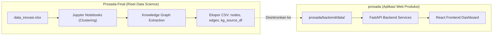

# PROSADA — JUSTINFO
### Platform Analitik, Clustering & Knowledge Graph Inovasi Daerah Jawa Timur

[](https://fastapi.tiangolo.com/)
[](https://react.dev/)
[](https://vitejs.dev/)
[](https://tailwindcss.com/)
[](https://groq.com/)
[](https://opensource.org/licenses/MIT)

**PROSADA** di bawah inisiatif **JUSTINFO** adalah sistem komprehensif untuk memetakan, menganalisis, dan memvisualisasikan ekosistem inovasi pemerintah daerah di seluruh wilayah Jawa Timur (bekerja sama dengan BRIDA Provinsi Jawa Timur).

Repository ini memadukan riset **Data Science**, pemodelan **Machine Learning (Clustering)**, pembentukan **Knowledge Graph (1.073 node & 5.817 relasi)**, serta aplikasi web interaktif dengan **Explainable AI (XAI) Chatbot**.

---

## Struktur Repository: Dua Bagian Utama

Repository ini terbagi secara tegas menjadi dua direktori yang memiliki peran, alur kerja, dan dokumentasi masing-masing:

```
JUSTINFO-/
├── 📁 Prosada-Final/    # 1. DIREKTORI RISET & DATA SCIENCE PIPELINE
│   ├── ... (Notebooks, Dataset Excel Mentah, Export GraphML & CSV)
│   └── 📄 README.md     # Panduan teknis riset data science & clustering
│
├── 📁 prosada/          # 2. DIREKTORI APLIKASI WEB PRODUKSI (SIAP DEPLOY)
│   ├── backend/         # REST API FastAPI + Knowledge Graph Data Service + XAI
│   ├── frontend/        # React 19 + Vite Dashboard + Peta Wilayah Leaflet
│   └── 📄 README.md     # Panduan instalasi lokal, API, & deployment cloud
│
├── .gitignore           # Aturan pengabaian berkas rahasia & build
└── README.md            # Dokumentasi umum repositori (berkas ini)
```

---

## Penjelasan Kedua Folder

### 1. `Prosada-Final/` — Riset, Eksperimen & Data Science Pipeline
Folder ini merupakan ruang kerja **analis data / data scientist** untuk memproses data mentah hingga menjadi Knowledge Graph terstruktur.

* **Fungsi Utama**:
  * Mengolah data mentah inovasi Jawa Timur dari BRIDA (`data_inovasi.xlsx`).
  * Melakukan eksplorasi data (EDA), pra-pemrosesan, dan ekstraksi fitur.
  * Menjalankan pemodelan **Clustering** untuk mengelompokkan kematangan inovasi kab/kota serta inovasi provinsi menjadi 3 tingkat (*Tinggi*, *Sedang*, *Rendah*).
  * Mengonstruksi jaringan Knowledge Graph multi-relasi (Inovasi, Daerah, OPD, Urusan, Bentuk, Jenis, Tahapan, Asta Cipta, dan Profil).
  * Mengekspor hasil riset ke format `GraphML` dan berkas CSV (`knowledge_graph_nodes.csv`, `knowledge_graph_edges.csv`, `kg_source_df.csv`).
* **Dokumentasi Lengkap**:  
 Silakan baca panduan lengkap notebook dan analisisnya di [**`Prosada-Final/README.md`**](Prosada-Final/README.md).

---

### 2. `prosada/` — Aplikasi Web Produksi Siap Deploy
Folder ini merupakan implementasi perangkat lunak **full-stack web application** yang siap digunakan oleh pengguna akhir dan siap di-deploy ke lingkungan produksi (misalnya Railway untuk Backend dan Vercel untuk Frontend).

* **Fungsi Utama**:
  * **Backend (FastAPI)**: Membaca dataset CSV hasil riset dengan in-memory caching (`@lru_cache`), menyediakan endpoint REST API untuk statistik wilayah, profil dominan, serta layanan chatbot.
  * **Frontend (React 19 + Vite)**: Menyajikan antarmuka modern yang responsif, visualisasi peta sebaran 38 kab/kota berbasis **Leaflet**, visualisasi statistik **Recharts**, serta penjelajah relasi graf.
  * **Explainable AI (XAI) Chatbot**: Asisten interaktif berbasis LLM (Groq API) yang langsung terhubung ke fakta Knowledge Graph (*Direct KG Context Injection*), menyajikan jawaban faktual lengkap dengan alur penalaran, entitas yang ditelusuri, dan tingkat keyakinan (*grounding*).
* **Dokumentasi Lengkap**:  
  Silakan baca panduan instalasi lokal, endpoint API, dan langkah deployment di [**`prosada/README.md`**](prosada/README.md).

---

## Alur Hubungan Antarbagian

Kedua folder dihubungkan oleh pertukaran artefak data:



Data yang telah dibersihkan dan distrukturkan oleh pipeline di `Prosada-Final/` diekspor sebagai CSV ke dalam direktori `prosada/backend/data/` agar backend FastAPI dapat memproses dan menyajikannya secara instan tanpa perlu menjalankan notebook ulang di server produksi.

---

## Klarifikasi Arsitektur AI (Tanpa RAG)

Pada fase eksperimen di notebook `Prosada-Final/`, sempat dilakukan pengujian prototipe retrieval aturan yang diistilahkan sebagai *Graph RAG*.

Namun pada **aplikasi web produksi (`prosada/`)**, sistem **TIDAK menggunakan RAG (Retrieval-Augmented Generation) konvensional**:
* **Tidak menggunakan Vector Database** (seperti Chroma, FAISS, Pinecone) maupun model embedding teks.
* Sistem menggunakan **Direct Knowledge Graph Context Injection + Explainable AI (XAI)**: fakta graf yang relevan dan kaya langsung disuntikkan secara deterministik ke dalam System Prompt LLM (Groq Cloud), menghasilkan jawaban transparan yang diverifikasi langsung oleh Knowledge Graph. Jika kunci API tidak diisi, sistem otomatis beralih ke engine Knowledge Graph lokal.

---

## Memulai Cepat

* Jika ingin **mempelajari analisis data, notebook, atau metodologi clustering**:
  * Masuk ke folder [`Prosada-Final/`](Prosada-Final/) dan buka [`Prosada-Final/README.md`](Prosada-Final/README.md).
* Jika ingin **menjalankan atau men-deploy aplikasi web dashboard**:
  * Masuk ke folder [`prosada/`](prosada/) dan buka [`prosada/README.md`](prosada/README.md).

---

## 📄 Lisensi & Kredit

Dikembangkan oleh Tim **JUSTINFO** bekerja sama dengan **BRIDA Provinsi Jawa Timur**.  
Lisensi di bawah [MIT License](LICENSE).
